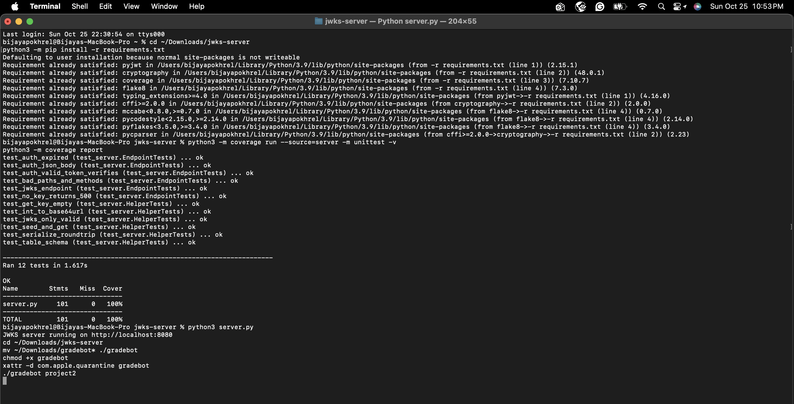

# CSCE 3550 – Project 2: SQLite-backed JWKS Server

**Author:** Bijaya Laxmi Pokhrel (EUID: blp0196)

A Python JWKS server that stores RSA private keys in SQLite
(`totally_not_my_privateKeys.db`) and serves JWTs and public JWKs.

## Features
- Creates/opens `totally_not_my_privateKeys.db` on start with the required `keys` table.
- On start, stores one **expired** key and one key valid for **1 hour**.
- Keys are saved as **PKCS1 PEM** and loaded back when needed.
- `POST /auth` signs a JWT with a valid key; `POST /auth?expired=true` uses an expired key.
- `GET /.well-known/jwks.json` returns all non-expired public keys.
- All SQL uses `?` query parameters to prevent SQL injection.

## Run
```bash
python3 -m pip install -r requirements.txt
python3 server.py        # http://localhost:8080
```

## Tests & coverage
```bash
python3 -m coverage run -m unittest -v
python3 -m coverage report -m
```

## Lint
```bash
python3 -m flake8 server.py test_server.py
```

## Screenshots
### Gradebot


### Test coverage


## AI use
Parts of this project were developed with help from an AI assistant (Claude).
